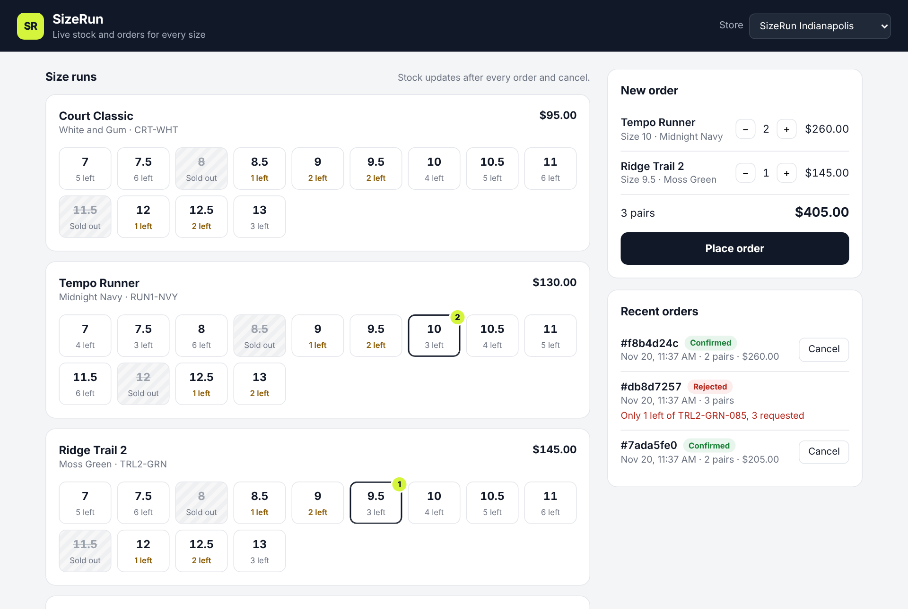
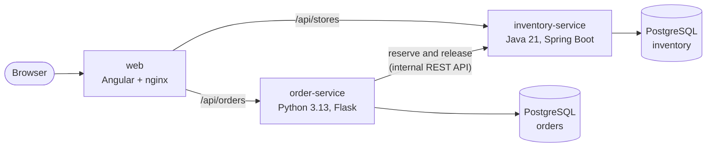

# SizeRun

Live store inventory and ordering, one shoe size at a time. SizeRun is a full-stack microservices app: a **Java and Spring Boot** inventory service, a **Python and Flask** order service, and an **Angular and TypeScript** web app, each service with its own **PostgreSQL** database. It runs in **Docker**, deploys to **Kubernetes**, and every commit is built, tested end to end, and published by **GitHub Actions**.

**Live demo: [mjsampsonmusic.github.io/sizerun](https://mjsampsonmusic.github.io/sizerun/)**, the store screen running in your browser with both services simulated on sample data ([how the demo works](#live-demo)).



## Why I built it

During my software engineering internship, I built the real-time inventory display for a retailer's in-store tablet app. That screen is only as good as the system behind it, which has to keep stock counts right while many people order at once. SizeRun is my version of that back end: every size has a live count, two shoppers can never buy the same last pair, and a dropped connection never creates a duplicate order.

## What it does

- Store staff pick a store and see each style's full size run (7 to 13 in half sizes) with live stock.
- Tapping sizes builds an order. Placing it reserves all of the stock at once, or none of it.
- An order for more than the store has is rejected with the reason, such as "Only 1 left of TRL2-GRN-085, 3 requested".
- Cancelling an order puts its stock back on the shelf, exactly once.

## Architecture



| Service | Stack | Owns |
| --- | --- | --- |
| `inventory-service` | Java 21, Spring Boot 3.5, Spring Data JPA (Hibernate), Flyway, PostgreSQL | Stores, products, stock, reservations |
| `order-service` | Python 3.13, Flask, SQLAlchemy, PostgreSQL | Orders and their status |
| `web` | Angular 22, TypeScript, signals, nginx | The store screen |

Each service owns its database, and they talk only through REST APIs. The reservation API is internal: nginx exposes `/api/stores` and `/api/orders` to the browser and nothing else.

## Design decisions

**No overselling, even under load.** Stock is taken with one conditional SQL update (`set quantity = quantity - :n ... where quantity >= :n`). PostgreSQL locks the row while it checks the count, so when 20 shoppers race for the last 5 pairs, exactly 5 succeed. `ReservationConcurrencyTest` runs that race with 20 threads against a real database.

**All or nothing.** An order for three sizes reserves all three in one transaction. If the third size is short, the first two go back automatically.

**No deadlocks.** Lines are sorted by SKU before any stock row is locked, so two orders that share sizes wait for each other instead of deadlocking. The second concurrency test sends orders with their lines in opposite order to prove it.

**Retries never double-order.** The web app sends an `Idempotency-Key` header with each order, and repeating a request returns the original order. The order service passes its order ID to inventory as the reservation key, so its own retries are safe too. If inventory is down, the order waits as `PENDING` and a retry finishes it.

**Errors that explain themselves.** Both services return RFC 9457 problem details (`application/problem+json`), and the order service maps outcomes to status codes: 201 confirmed, 409 rejected, 503 pending.

**Built for several replicas.** Spring Boot Actuator and Flask expose liveness and readiness probes, and schema setup is safe when replicas start together (Flyway's migration lock in Java, a PostgreSQL advisory lock in Python).

## Run it

You need Docker.

```bash
docker compose up --build
```

Open http://localhost:4200. In another terminal, run the end-to-end check:

```bash
bash scripts/smoke-test.sh
```

## Live demo

The [live demo](https://mjsampsonmusic.github.io/sizerun/) is the same Angular app, built with `npm run build:demo`. In that build, an Angular HTTP interceptor (`web/src/app/demo/`) answers the app's `/api` calls inside the browser instead of over the network. It follows the same rules as the two services: all-or-nothing reservations, `Idempotency-Key` replays, pending orders during an outage, and cancels that put stock back once. It also opens with the same stock as the database seed.

To see the retry design work, tick **Simulate an inventory outage**, place an order, then untick it and press **Retry**: the pending order is confirmed, not duplicated. A page refresh starts over. A separate workflow ([pages.yml](.github/workflows/pages.yml)) publishes the demo to GitHub Pages on every push to `main`.

## Tests

| Suite | What it covers | Command |
| --- | --- | --- |
| `inventory-service` | 11 JUnit tests on a real PostgreSQL database: REST API, all-or-nothing reservations, a 20-thread race, the deadlock check | `make db` then `make test-inventory` |
| `order-service` | 25 pytest tests: idempotent orders, inventory outages, cancels, validation, the HTTP client | `make db` then `make test-orders` |
| `web` | 23 Vitest tests: cart rules, API calls, the order flow, rendering, and the demo's stand-in services | `make test-web` |
| End to end | The Docker Compose stack: order, retry, reject, and cancel through nginx | `make up` then `make smoke` |

## CI/CD

GitHub Actions runs on every push and pull request ([workflow](.github/workflows/ci.yml)):

1. Builds and tests the three services in parallel. The Java and Python suites run against a PostgreSQL service container.
2. Starts the whole stack with Docker Compose and runs the smoke test against it.
3. On `main`, publishes all three images to GitHub Container Registry, tagged with the commit SHA and `latest`.
4. A separate workflow builds the live demo and publishes it to GitHub Pages.

## Deploy to Kubernetes

The `k8s/` folder holds Deployments with startup, liveness, and readiness probes and resource limits, a PostgreSQL StatefulSet, Services, and an Ingress. Change the placeholder password in `k8s/postgres.yaml` first, then:

```bash
kubectl apply -k k8s/
```

## API

Inventory service, port 8080:

| Method | Path | Notes |
| --- | --- | --- |
| GET | `/api/stores` | All stores |
| GET | `/api/stores/{code}/catalog` | Styles with their size runs and live stock |
| POST | `/api/reservations` | Internal. 201 new, 200 repeat of the same order, 409 not enough stock |
| POST | `/api/reservations/{id}/release` | Internal. Safe to call twice |
| GET | `/actuator/health/liveness`, `/actuator/health/readiness` | Kubernetes probes |

Order service, port 8000:

| Method | Path | Notes |
| --- | --- | --- |
| POST | `/api/orders` | Requires an `Idempotency-Key` header. 201 confirmed, 409 rejected, 503 pending |
| GET | `/api/orders?store=IND01` | Newest first |
| GET | `/api/orders/{id}` | One order |
| POST | `/api/orders/{id}/cancel` | Puts the stock back |
| GET | `/healthz`, `/readyz` | Kubernetes probes |

## Project layout

```
inventory-service/   Java 21 + Spring Boot: catalog, stock, reservations, Flyway migrations, JUnit tests
order-service/       Python 3.13 + Flask: orders, inventory client, pytest tests
web/                 Angular 22 + TypeScript: store screen, demo mode, Vitest tests, nginx config
k8s/                 Kubernetes manifests (kubectl apply -k k8s/)
db/init/             Creates one database per service for Docker Compose
scripts/             End-to-end smoke test
.github/workflows/   CI/CD pipeline
```

## Notes

Built with AI pair programming (Claude). Store names, styles, prices, and stock are made up.
